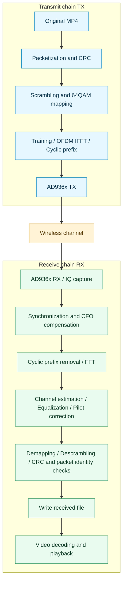

# LuxLink SDR Wireless Video Transmission System

[简体中文](README.md) | **English**

An experimental video loopback application built with Python, Tkinter, and AD936x/libiio. It transfers the original MP4 bitstream using a custom OFDM waveform, verifies packets with CRC, selectively retransmits missing packets, and displays both videos alongside live receiver diagnostics.

**Current default: 1080p source material, 64QAM, 3 MSPS, a 1024-point FFT, and original-bitstream transport. The only Windows batch launcher is `run_1080p30_64qam.bat`.**

This project uses a custom waveform; it is **not a Wi-Fi or cellular implementation**. Testing currently covers TX/RX loopback on a single radio board. An end-to-end protocol between independent devices and an FPGA receiver baseband have not been implemented and validated.

## Test Screenshots

### Video Loopback and OFDM Diagnostics

The RF loopback view compares transmitted and received video. The lower panels show the spectrum waterfall and trace, constellations before and after equalization, and effective throughput. This screenshot shows 100% transfer progress and reception through frame 941.


### CSI Channel Observation

Amplitude and phase histories for 10 selected subcarriers, together with amplitude and phase heatmaps across all active subcarriers. These measurements are uncalibrated; heatmap colors represent values, not antenna counts.


These screenshots document local tests and the application interface. They do not establish performance under arbitrary conditions.

## Features

- **Original-bitstream transport:** no video re-encoding, with transfer integrity and media-payload verification.
- **Persistent DMA transport:** separate TX, IQ reception, and decoding threads; background waveform preparation and device-buffer reuse.
- **Reliable reception:** CRC, packet identity checks, and selective retransmission. Original transport requires CRC.
- **Signal-loss handling:** retain correctly received packets and wait for signal recovery; manual cancellation remains available.
- **Video comparison:** TX/RX previews and a fullscreen RX view on the same monitor as the main window. Press Esc to return.
- **Transfer progress:** received bytes, total bytes, and percentage at the top of the window.
- **Receiver diagnostics:** spectrum trace and waterfall, constellations before/after equalization, and effective-throughput history.
- **CSI observation:** a channel-status page with time series, heatmaps, and CSV logging. Standalone CSI acquisition and video transmission are mutually exclusive.

Previews use resized JPEG images to reduce display overhead. **This does not alter the saved file in original-bitstream mode.** Old previews may be skipped when the GUI is busy; the preview count is not the number of frames in the received file.

## Transmit and Receive Flow



Missing packets are selectively retransmitted based on reception results available to the same host process. **This does not implement an over-the-air ACK channel from an independent receiver.**

## Requirements

The current development and validation environment is **Windows, 64-bit Python 3.11, and a libiio-compatible AD936x radio board**.

- Python dependencies: [requirements.txt](requirements.txt). Python 3.11 is recommended for reproduction; other versions are not all validated.
- Windows native libraries are provided in `Windows-VS-2022-x64/`, targeting libiio 0.25.
- Install the appropriate device driver and confirm that libiio can enumerate the board.
- Do not access the same radio concurrently from IIO Oscilloscope or another application.
- Use `simulate` mode to test the algorithms and video pipeline without radio hardware.

To use an external libiio directory in PowerShell:

```powershell
$env:IIO_LIB_DIR = "C:\path\to\libiio"
```

The directory must contain `libiio.dll` and its matching runtime dependencies.

## Quick Start

Run all commands from the project root. **The application interface is currently Chinese; the language links switch the documentation only.**

### Windows EXE (No Python Installation Required)

Download the Windows x64 portable bundle from the [latest Release](https://github.com/lx8863/luxlink-sdr/releases/latest), extract it, and run `LuxLink-SDR.exe`. Python and runtime dependencies are bundled. Install the radio driver separately and select your own video. See [Windows EXE notes](docs/WINDOWS-EXE.md) for build instructions, output paths and validation.

The following steps are for running from source.

### 1. Launch the GUI

Double-click the launcher or run:

```powershell
.\run_1080p30_64qam.bat
```

On first launch, the script creates `.venv` and installs Python dependencies, requiring an internet connection. It is self-contained and does not depend on another batch launcher.

Alternatively, install and launch manually:

```powershell
python -m venv .venv
.\.venv\Scripts\python.exe -m pip install -r requirements.txt
.\.venv\Scripts\python.exe -m video_loopback.gui --profile ofdm-original-1080p30-64qam
```

### 2. Select a Video and Radio

1. Open the settings page (参数与文件设置) and select the “1080p30 原画质 / 64QAM” preset.
2. Choose a local MP4 and check the output/report paths to avoid overwriting files you need.
3. Detect the radio and select its actual `usb:` URI. The address may change after reconnection.
4. Return to the demonstration page (演示 / OFDM 观测) and click “开始发送并接收” to start.

The default input is `examples/1080p/ocean_1080p30_original.mp4` when that local material is available. Videos are not included in the GitHub repository; select your own input or follow [the sample instructions](examples/README.md). In original mode, dimensions, frame rate, and bitrate come from the source. **The 1080p30 settings do not convert an arbitrary source to 1080p30.**

Enumerate IIO devices:

```powershell
.\Windows-VS-2022-x64\iio_info.exe -s
```

### 3. Simulate Without a Board

```powershell
.\run_1080p30_64qam.bat --mode simulate --input "C:\videos\input.mp4"
```

Simulation does not replace RF performance or stability testing.

## Default OFDM Configuration

| Parameter | Default / description |
| --- | --- |
| Center frequency | 2400 MHz |
| IQ sample rate | 3 MSPS |
| Modulation | 64QAM, 6 bits per data symbol |
| FFT / cyclic prefix | 1024 / 64 samples |
| Data subcarriers | 792 |
| Pilot subcarriers | 8 |
| Unused bins | 224, including DC and guard bands |
| Subcarrier spacing | Approximately 2.93 kHz |
| Active-subcarrier bandwidth | Approximately 2.34 MHz |
| Batch size | 256 packets, up to 1024 payload bytes per packet |
| Persistent-transport training groups | 16 packets per group by default; the final group may be padded |
| TX / RX gain | 0 / 28 dB, a local test starting point only |
| Transport / playback | `original` / `realtime` |
| CRC | Enabled |

See [profiles.py](video_loopback/profiles.py). Suitable gains and modulation orders depend on channel conditions; these settings are not optimal for every board or distance.

## Interface and Charts

From top to bottom: transfer progress, TX/RX video previews, four diagnostic columns, status, and logs.

| Position | Chart | Interpretation |
| --- | --- | --- |
| Column 1, upper | Spectrum waterfall | Frequency in MHz, relative time in seconds, latest 10 seconds with newest data at the bottom; per-frame peak-relative power from -80 to 0 dB |
| Column 1, lower | Receive spectrum | Signal bandwidth, in-band notches, and out-of-band energy; frequency axis aligned with the waterfall |
| Column 2 | Before equalization | FFT output data symbols with overall amplitude normalization |
| Column 3 | After equalization | Channel-equalized data symbols after pilot amplitude/phase correction; ideal 64QAM positions form an 8-by-8 grid |
| Column 4 | Effective throughput | Green: effective receive rate in Mbps. Dashed orange: average source-video bitrate |

- Constellations combine sampled symbols from multiple data subcarriers on one I/Q plane. Their complex values are not summed; these are not separate plots for individual subcarriers.
- Spectrum and waterfall values are peak-normalized, **not calibrated dBm measurements**. Each spectrum has a 0 dB peak, so absolute received-power changes cannot be inferred across frames.
- Throughput counts unique effective payload bytes in fixed one-second windows, without counting retransmitted duplicates. Completed history is not redistributed while scrolling. A final partial window uses its actual duration.
- The green curve includes effects of decoding/playback queue backpressure and is not a link-capacity benchmark. The orange line is an average, not instantaneous video demand; briefly exceeding it does not guarantee uninterrupted playback.
- The waterfall freezes at 100% transfer progress, on cancellation, or at task completion. A new transfer clears it. Buffered video may continue playing after transmission finishes.
- Diagnostic rendering is paused during fullscreen RX playback and resumes when returning to the main view.

## CLI and Tests

For the CLI, **add `--ofdm-streaming` explicitly to enable persistent DMA transport**. The GUI enables this backend for original-bitstream OFDM.

```powershell
.\.venv\Scripts\python.exe -m video_loopback.cli "C:\videos\input.mp4" --profile ofdm-original-1080p30-64qam --ofdm-streaming --mode rf --uri "usb:" --output examples/received.mp4 --report examples/received.json
```

List options and run the automated tests:

```powershell
.\run_1080p30_64qam.bat --help
.\.venv\Scripts\python.exe -m video_loopback.cli --help
.\.venv\Scripts\python.exe -m unittest discover -s tests -v
```

Tests cover modulation/demodulation, original-bitstream integrity, errors and cancellation, simulated DMA transport, charts, and window behavior. Tk tests require a desktop session. Passing tests do not establish RF performance under arbitrary conditions.

## Local Measurement and Rate Definitions

The following is **one historical local RF run from October 16, 2026**, not a new RF acceptance test of every subsequent GUI change or a performance guarantee for other distances, environments, or independent devices. See the [report excerpt](docs/reports/1080p64qam-local-run.json).

| Metric | Result |
| --- | --- |
| Video | 1920×1080, 941 frames, approximately 31.33 seconds |
| Required average file rate | 3.625 Mbps |
| Effective batch transfer rate | 5.716 Mbps |
| Received / lost / late frames | 941 / 0 / 0 |
| Selectively retransmitted packets | 100; original packet count: 13,864 |
| Startup time | 3.701 seconds |
| Integrity | Complete transfer; identical media payload |
| GUI previews | 894 draws, 47 skipped frames, maximum display gap of 125 ms |

An intact received file and timely display of every frame are separate outcomes. This run should not be described as completely stutter-free.

**Three rates must be distinguished:**

1. **Theoretical waveform data-symbol rate:** approximately `792 × 6 × 3,000,000 / (1024 + 64) ≈ 13.1 Mbps`, before training, headers, padding, retransmissions, and implementation delays.
2. **Report field `net_transfer_mbps`:** effective bytes divided by accumulated `transceive_batch` call time. It excludes some queue waits and total playback time.
3. **The green GUI curve:** effective byte increments after completed batch delivery, measured against wall-clock time, including waits between progress updates.

`Mbps` means megabits per second; `MB/s` means megabytes per second. `10 MB/s = 80 Mbps`. The current configuration cannot reach 80 Mbps.

## Limitations and Troubleshooting

- Input comes from a file, not a zero-latency camera pipeline. Playback requires startup buffering.
- Original mode may remux MP4 without re-encoding. The output container need not be byte-identical to the source; inspect media-payload and transfer-integrity checks separately.
- Original mode requires `--max-frames 0`. Encoding bitrate and output-size controls apply to other transport modes.
- The GUI currently previews video; retaining audio tracks in the original transport does not imply synchronized audio playback.
- Custom OFDM currently lacks FEC and complete sample-clock drift tracking. Long-running operation between independent devices remains unvalidated.
- 256QAM has produced high packet loss in local RF conditions; retransmissions can reduce effective throughput despite a higher modulation order.
- Persistent transport waits when the RF signal disappears. Actual device removal or unrecoverable failures still raise errors.
- Inspect GUI logs and `examples/radio_worker_errors.log`. Some transient I/O errors are handled by rebuilding DMA buffers.
- An FPGA receiver has only been discussed at the architecture level; **no working FPGA receiver implementation has been delivered or validated**.

## Project Structure

```text
run_1080p30_64qam.bat   Only Windows batch launcher
requirements.txt       Python dependency ranges
video_loopback/
  gui.py               GUI, worker process, preview queues and events
  profiles.py          Presets and default file paths
  original.py          Original transport, integrity checks and playback
  streaming_radio.py   Persistent DMA TX/RX, decoding and selective retry
  radio.py             AD936x access, simulation and other radio backends
  ofdm.py              Training, synchronization, FFT, equalization and pilots
  modem.py             Packets, CRC, scrambling and QAM mapping
  ofdm_ui.py           Spectrum and constellation diagnostics
  spectrum_waterfall.py Spectrum history and freezing
  quality_ui.py        Effective-throughput history
  csi.py               CSI display and logging
examples/
  download_ocean_materials.py  Download and remux two ocean clips
  1080p/               Local material and received files (not committed)
tests/                 Automated tests
docs/reports/          Small measurement excerpts without machine paths
Windows-VS-2022-x64/    Windows libiio tools and runtime dependencies
```

## Media and Third-Party Licenses

- Local ocean clips have source and media information in corresponding `*.source.json` files. Each source has its own licensing terms.
- `examples/download_ocean_materials.py` uses system `curl.exe` to download Dareful's distributed 1080p versions, then remuxes them with FFmpeg without re-encoding. Source and CC BY 4.0 attribution are recorded with the files. Third-party URLs may change.
- The libiio license is in [LICENSE-libiio.txt](LICENSE-libiio.txt); it does not automatically license the entire project.
- No project-wide open-source license has been selected. A public GitHub repository does not automatically grant unrestricted reuse rights.

## Historical Documentation

This README describes the current launcher, defaults, and interface. The following Chinese documents preserve older experiments; their removed launchers, old layouts, modulation settings, and rates do not describe the current default configuration:

- [Archived README](README-HISTORY.md)
- [1080p30 / 64QAM validation](1080p30-64QAM验证.md)
- [Original-quality real-time throughput work](原画质实时吞吐优化.md)
- [OFDM CSI notes](OFDM-CSI说明.md)
- [Channel acquisition notes](CHANNEL-SENSING.md)

## Star History

<a href="https://www.star-history.com/?repos=lx8863%2Fluxlink-sdr&amp;type=date">
  <picture>
    <source media="(prefers-color-scheme: dark)" srcset="https://api.star-history.com/svg?repos=lx8863/luxlink-sdr&amp;type=Date&amp;theme=dark" />
    <source media="(prefers-color-scheme: light)" srcset="https://api.star-history.com/svg?repos=lx8863/luxlink-sdr&amp;type=Date" />
    
  </picture>
</a>
