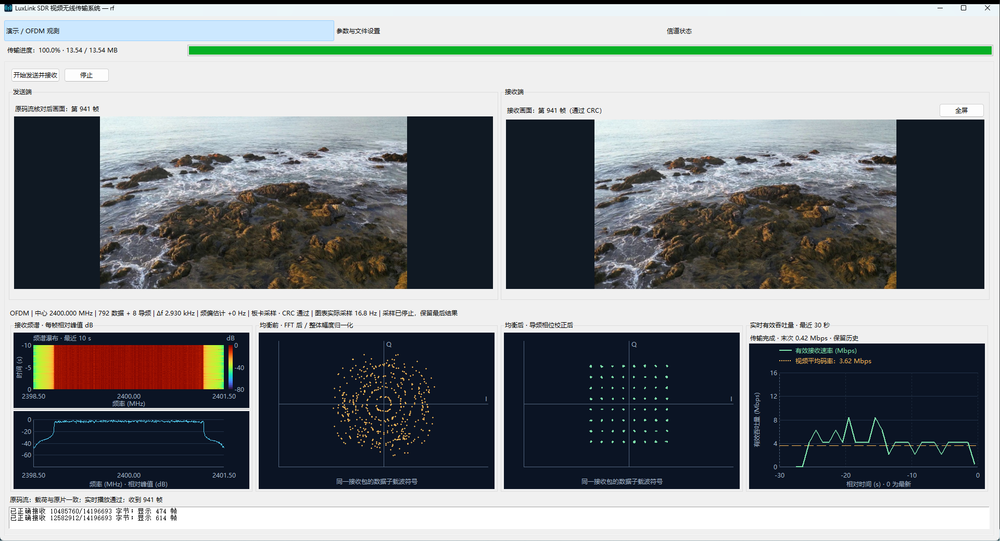
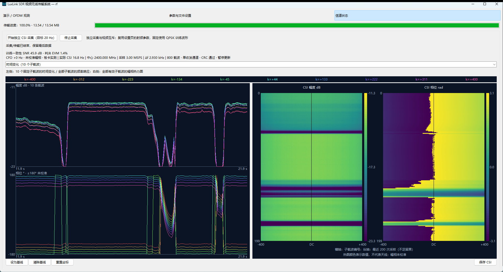
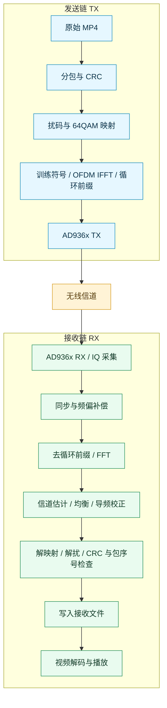

# LuxLink SDR视频无线传输系统

基于 Python、Tkinter 和 AD936x/libiio 的视频自发自收实验项目。支持原始 MP4 码流透传、OFDM 调制解调、CRC 校验与缺包重传，并在上位机中同步显示发送视频、接收视频和接收诊断图。

**当前默认：1080p 素材、64QAM、3 MSPS、1024 点 FFT、原码流传输。唯一批处理入口为 `run_1080p30_64qam.bat`。**

本项目采用自定义波形，**不是 Wi-Fi 或蜂窝协议实现**。目前验证的是同一块射频板的 TX/RX 自发自收，尚未完成两块独立设备之间的端到端无线协议和 FPGA 接收基带。

## 测试界面

### 视频收发与 OFDM 观测

同板 RF 自发自收界面：发送与接收视频并排对比，下方展示接收频谱瀑布与曲线、均衡前后星座及有效吞吐量。截图中传输进度为 100%，接收至第 941 帧。



### CSI 信道状态

展示 10 个选定子载波的幅度、相位时序，以及全部有效子载波的 CSI 幅度与相位热力图。图中幅相未校准，热图颜色表示数值变化，不代表天线数量。



两张截图由本地测试取得，用于展示界面与观测结果；不代表任意环境下均可达到相同传输性能。

## 功能

- **原码流传输**：不重新编码视频；接收文件做完整性和媒体载荷一致性校验。
- **持续 DMA 收发**：发送、IQ 接收、解调分别执行，后台准备后续 OFDM 波形，复用设备缓冲。
- **可靠接收**：CRC 校验、包序号检查、缺包选择性重传；原码流模式必须开启 CRC。
- **信号中断等待**：持续收发模式保留已收包，等待信号恢复；允许手动停止。
- **视频对比**：发送与接收预览；接收端可全屏，跟随主窗口所在显示器，按 Esc 返回。
- **传输进度**：顶部显示已正确接收字节数、总大小和百分比。
- **接收诊断**：频谱曲线与瀑布图、均衡前后星座、有效吞吐量趋势。
- **CSI 采集**：单独的信道状态页，支持时序、热图及 CSV 记录；独立采集与视频传输互斥。

预览通过 JPEG 缩放图像传给界面，用于降低显示开销；**预览处理不改变原码流模式下保存的接收文件**。界面繁忙时可能跳过旧预览，预览显示次数不等于文件实际帧数。

## 收发流程



缺包时，同板收发程序根据已收到的包选择性重发。这里的重传由同一个主机进程协调，**不表示已经实现独立接收端通过空口回传 ACK**。

## 运行环境

当前开发与验证环境为 **Windows、64 位 Python 3.11、支持 libiio 的 AD936x 射频板**。

- Python 依赖见 [requirements.txt](requirements.txt)。建议使用 Python 3.11 复现；未声明其他版本均已验证。
- Windows 本机库位于 `Windows-VS-2022-x64/`，当前适配 libiio 0.25。
- 连接射频板前需配置匹配的设备驱动，并确保能通过 libiio 枚举。
- 同一设备不要同时由 IIO Oscilloscope 或其他程序占用。
- 未连接射频板时，可先使用 `simulate` 模式验证算法和视频流程。

需要使用外部 libiio 目录时，在 PowerShell 中指定：

```powershell
$env:IIO_LIB_DIR = "C:\path\to\libiio"
```

该目录应包含 `libiio.dll` 及匹配的运行依赖。

## 快速开始

以下命令均在项目根目录执行。

### 1. 启动上位机

双击或执行：

```powershell
.\run_1080p30_64qam.bat
```

首次启动会创建 `.venv` 并安装 Python 依赖，需要联网。启动脚本已包含完整启动逻辑，不依赖其他 `.bat`。

也可手动安装并启动：

```powershell
python -m venv .venv
.\.venv\Scripts\python.exe -m pip install -r requirements.txt
.\.venv\Scripts\python.exe -m video_loopback.gui --profile ofdm-original-1080p30-64qam
```

### 2. 选择素材与板卡

1. 在“设置”页点击“1080p30 原画质 / 64QAM”加载当前预设。
2. 选择本地 MP4，确认输出文件和报告路径，避免覆盖需要保留的文件。
3. 检测板卡，选择实际 `usb:` URI；重新插拔后设备地址可能变化。
4. 返回“演示”页，点击开始发送并接收。

如保留了随项目准备的素材，默认输入为 `examples/1080p/ocean_1080p30_original.mp4`。GitHub 仓库若不包含该视频，需自行选择素材。原码流模式以源文件分辨率、帧率及码率为准，**设置中的 1080p30 不会将任意源视频转换成 1080p30**。

检测 IIO 设备：

```powershell
.\Windows-VS-2022-x64\iio_info.exe -s
```

### 3. 无板仿真

```powershell
.\run_1080p30_64qam.bat --mode simulate --input "C:\videos\input.mp4"
```

仿真不能代替真实射频性能和稳定性验证。

## 当前默认 OFDM 参数

| 参数 | 默认值 / 说明 |
| --- | --- |
| 中心频率 | 2400 MHz |
| IQ 采样率 | 3 MSPS |
| 调制 | 64QAM，每个数据符号携带 6 bit |
| FFT / 循环前缀 | 1024 / 64 个采样点 |
| 数据子载波 | 792 个 |
| 导频子载波 | 8 个 |
| 空频点 | 224 个，包含直流与保护频带 |
| 子载波间隔 | 约 2.93 kHz |
| 有效子载波占用带宽 | 约 2.34 MHz |
| 每批数据包 | 256 包，每包有效载荷最多 1024 字节 |
| 持续收发训练分组 | 默认每 16 包一组；尾组可能补齐 |
| TX / RX 增益 | 0 / 28 dB，仅为本地验证起点 |
| 传输 / 播放 | `original` / `realtime` |
| CRC | 开启 |

以上参数见 [profiles.py](video_loopback/profiles.py)。增益和可用调制阶数随信道变化，不能把本地增益作为所有板卡和距离下的最优值。

## 界面与图表

演示页从上到下为：传输进度、发送/接收视频、四列诊断区域、状态和日志。

| 位置 | 图表 | 阅读方式 |
| --- | --- | --- |
| 第一列上方 | 频谱瀑布热力图 | 横轴频率 MHz，纵轴相对时间 s，最近 10 秒，最新在底部；颜色为每帧相对峰值 dB，范围 −80～0 dB |
| 第一列下方 | 实时接收频谱 | 显示信号带宽、带内凹陷和带外能量；与上方频率轴对齐 |
| 第二列 | 均衡前星座 | FFT 后、整体幅度归一化的数据子载波符号 |
| 第三列 | 均衡后星座 | 信道均衡及导频幅相校正后的数据符号；64QAM 理想位置为 8×8 |
| 第四列 | 实时有效吞吐量 | 绿线为有效接收速率 Mbps，橙色虚线为视频平均码率 |

说明：

- 星座图汇集多个数据子载波的抽样符号，不是把各子载波 I/Q 数值相加，也不是每个子载波一张图。
- 频谱、瀑布图采用相对峰值归一化，**不是校准后的 dBm 测量**；各时刻峰值均归一化为 0 dB，不能据此比较绝对接收功率变化。
- 吞吐量按固定一秒窗口统计唯一有效载荷，不重复计算重传数据；正常传输的历史点不会随滚动重新分配。结束时最后不足一秒的窗口按实际时长计算。
- 绿线受解码和播放队列等待影响，不能直接作为链路最大吞吐量。橙线是文件平均码率，不是瞬时码率，短时高于参考线也不保证全程不卡顿。
- 传输达到 100% 后瀑布图冻结；手动停止或任务结束也保留历史。下一次开始时清空。传输完成后，缓冲中的视频仍可能继续播放。
- 全屏接收视频时暂停诊断图绘制以减少开销；返回后恢复。

## 命令行与测试

命令行使用相同预设时，**持续 DMA 后端需显式添加 `--ofdm-streaming`**；GUI 的原码流 OFDM 配置会启用该后端。

```powershell
.\.venv\Scripts\python.exe -m video_loopback.cli "C:\videos\input.mp4" --profile ofdm-original-1080p30-64qam --ofdm-streaming --mode rf --uri "usb:" --output examples/received.mp4 --report examples/received.json
```

查询选项、运行自动化测试：

```powershell
.\run_1080p30_64qam.bat --help
.\.venv\Scripts\python.exe -m video_loopback.cli --help
.\.venv\Scripts\python.exe -m unittest discover -s tests -v
```

测试包含调制解调、原码流完整性、异常和停止处理、模拟 DMA 收发、图表及窗口行为。Tk 测试需要可用的桌面会话。测试通过不表示任意射频条件下均达到相同表现。

## 本地实测记录与速率口径

以下为 **2026-10-16 的一次历史本地 RF 运行**，不是最新全部界面改动后的重新射频验收，也不是不同距离、环境或独立设备间的性能承诺。摘录见 [运行报告](docs/reports/1080p64qam-local-run.json)。

| 项目 | 结果 |
| --- | --- |
| 视频 | 1920×1080，941 帧，约 31.33 秒 |
| 文件平均所需速率 | 3.625 Mbps |
| 批次有效传输速率 | 5.716 Mbps |
| 接收帧 / 丢帧 / 迟到帧 | 941 / 0 / 0 |
| 选择性重传包数 | 100 包；原始数据包 13,864 包 |
| 起播时间 | 3.701 秒 |
| 接收完整性 | 完整传输，媒体载荷一致 |
| 界面预览 | 绘制 894 次，跳过 47 帧，最大显示间隔 125 ms |

“接收文件完整”与“每帧都被界面及时显示”是不同指标。此记录不应表述为完全无卡顿。

**三个速率不能混用：**

1. **波形理论数据符号速率**：当前配置约 `792 × 6 × 3,000,000 / (1024 + 64) ≈ 13.1 Mbps`，尚未扣除训练、包头、填充、重传及实现等待。
2. **报告 `net_transfer_mbps`**：有效字节数除以累计 `transceive_batch` 调用耗时，不包含所有队列等待和完整播放时间。
3. **界面绿线**：已完成批次交付后的有效字节增量按墙钟时间统计，包含这些进度更新之间的等待。

`Mbps` 是兆比特每秒，`MB/s` 是兆字节每秒；`10 MB/s = 80 Mbps`。当前配置不能达到 80 Mbps。

## 当前限制与常见问题

- 当前是文件输入，不是摄像头零延迟传输；播放器存在起播缓冲。
- 原码流模式不重新编码，但可能重封装 MP4；输出容器文件未必与原始文件逐字节一致。应同时查看媒体载荷校验和传输完整性指标。
- 原码流模式不支持截断帧数，`--max-frames` 必须为 0；码率、尺寸等编码设置用于其他传输模式。
- 当前 GUI 主要预览视频；原码流保留的音轨不表示已经实现同步音频播放。
- 自定义 OFDM 尚无 FEC 和完整采样时钟漂移跟踪，独立端点的长期稳定运行尚待验证。
- 256QAM 在现有射频条件下出现过严重误包，提高阶数可能因重传降低有效吞吐。
- 天线信号消失时持续收发后端会等待；实际设备断开、不可恢复错误仍会报告异常。
- 运行错误可查看界面日志及 `examples/radio_worker_errors.log`；`OSError` 等错误的部分情况支持重建 DMA 缓冲后恢复。
- 当前 FPGA 接收链路仅讨论过架构，**没有交付或验证可用的 FPGA 接收实现**。

## 代码结构

```text
run_1080p30_64qam.bat   唯一 Windows 启动入口
requirements.txt       Python 依赖范围
video_loopback/
  gui.py               界面、工作进程、预览队列与运行事件
  profiles.py          参数与默认素材路径
  original.py          原码流传输、文件校验、解码与播放调度
  streaming_radio.py   持续 DMA 发送、接收、解调与选择性重传
  radio.py             AD936x 接口、仿真与其他收发后端
  ofdm.py              OFDM 训练、同步、FFT、均衡与导频校正
  modem.py             包格式、CRC、扰码与 QAM 映射
  ofdm_ui.py           频谱与星座诊断
  spectrum_waterfall.py 频谱瀑布历史与冻结
  quality_ui.py        有效吞吐量趋势图
  csi.py               CSI 显示与记录
examples/              素材、下载工具与本地实验输出
  download_ocean_materials.py  下载两段海浪素材并无重编码封装
  1080p/               本地海洋素材与接收输出
  ...
tests/                 自动化测试
docs/reports/          不含机器绝对路径的实测摘录
Windows-VS-2022-x64/    Windows libiio 工具与依赖
```

## 素材与第三方许可

- 本地海洋素材的来源、帧率、时长等记录在对应 `*.source.json`。不同来源的授权条件分别适用。
- `examples/download_ocean_materials.py` 使用系统 `curl.exe` 下载 Dareful 海浪素材的 1080p 分发版本，并通过 FFmpeg 无重编码封装；其来源和 CC BY 4.0 署名信息随文件记录。下载地址由第三方提供，可用性可能变化。
- libiio 的许可见 [LICENSE-libiio.txt](LICENSE-libiio.txt)。该许可不自动适用于本项目全部代码。
- 当前未设置项目整体的开源许可证。发布者应在确定授权方式后添加根目录 `LICENSE`，不要将公开 GitHub 仓库误认为自动授予任意使用权。

## 历史文档

当前入口、参数和界面以本 README 为准。以下文件保留历史实验信息，其中旧启动脚本、旧布局、旧调制及吞吐数据不代表当前默认配置：

- [旧 README 归档](README-HISTORY.md)
- [1080p30 / 64QAM 验证](1080p30-64QAM验证.md)
- [原画质实时吞吐优化](原画质实时吞吐优化.md)
- [OFDM CSI 说明](OFDM-CSI说明.md)
- [信道采集说明](CHANNEL-SENSING.md)

## Star History

<a href="https://www.star-history.com/?repos=lx8863%2Fluxlink-sdr&amp;type=date">
  <picture>
    <source media="(prefers-color-scheme: dark)" srcset="https://api.star-history.com/svg?repos=lx8863/luxlink-sdr&amp;type=Date&amp;theme=dark" />
    <source media="(prefers-color-scheme: light)" srcset="https://api.star-history.com/svg?repos=lx8863/luxlink-sdr&amp;type=Date" />
    
  </picture>
</a>
